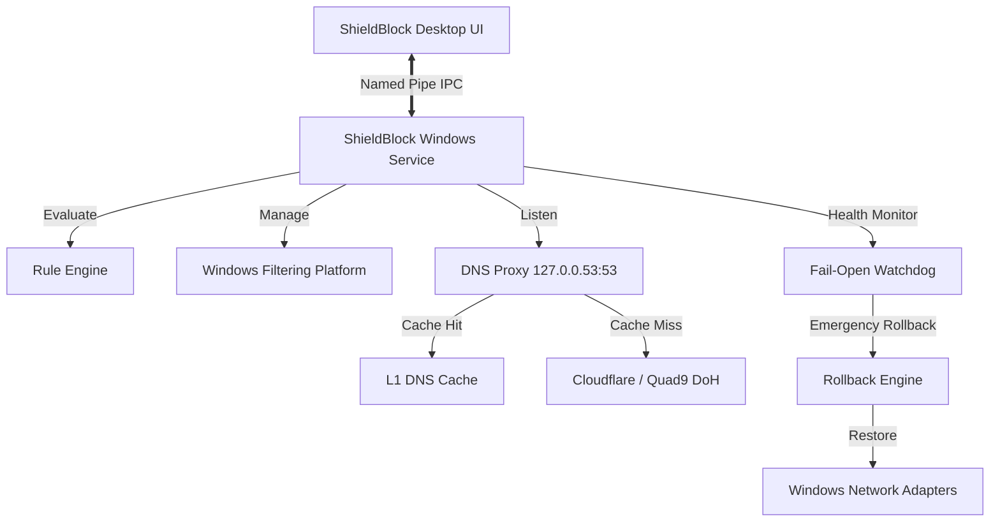

# ShieldBlock 🛡️

**Safe System-Wide Windows Network Ad & Tracker Blocker**

*Designed with safety-first principles, zero registry corruption, zero kernel drivers, and guaranteed fail-open internet continuity.*

---

## 🌟 Overview

**ShieldBlock** is a professional, privacy-first Windows system-wide network filtering application. It operates entirely in user mode via the **Windows Filtering Platform (WFP)** and a local **Fail-Open DNS-over-HTTPS (DoH) Proxy Engine**.

Unlike invasive tools that risk breaking Windows, installing unstable third-party kernel drivers, or modifying critical Windows Registry keys, ShieldBlock adheres to **strict, inviolable safety invariants**:
- **Zero Kernel Drivers:** 100% safe user-mode WFP (`fwpuclnt.dll` BFE API) & local loopback socket filtering.
- **Zero Arbitrary Registry Writes:** All settings, statistics, and filter lists live strictly in atomic JSON stores under `%ProgramData%\ShieldBlock\` and `%AppData%\ShieldBlock\`.
- **Fail-Open by Design:** If any component halts, crashes, or loses power, normal unblocked Internet connectivity continues automatically without disruption.
- **Coexistence Guarantee:** Zero interference with Windows Defender, Windows Firewall, or corporate VPNs.
- **Triple-Action Emergency Circuit Breaker:** Instant recovery via UI button, global `Ctrl + Shift + F12` hotkey, or standalone `ShieldBlockRecovery.exe`.

---

## 🚀 Key Features

| Feature | Description |
| :--- | :--- |
| **Fail-Open DNS Proxy** | High-performance async UDP/TCP proxy listening on `127.0.0.53:53` with upstream Cloudflare (`1.1.1.1`) & Quad9 (`9.9.9.9`) DoH. |
| **High-Throughput Rule Engine** | Single-pass ABP/uBlock parser supporting `||domain^`, exception rules `@@||`, and cosmetic rules `##`. Benchmarked at **> 125,000 queries/sec**. |
| **Dynamic WFP Sessions** | Dynamic BFE sessions tagged with ShieldBlock Provider GUID `{5147424C-0001-4000-8000-536869656C64}`. Auto-purged by Windows on termination. |
| **Crash Watchdog & Safe Mode** | Automatic detection of unclean shutdowns; enters Safe Mode and restores network defaults after 3 consecutive failures. |
| **Per-App Network Tracker** | Live socket inspection via Win32 `GetExtendedTcpTable` to display active processes and apply granular per-app bypasses. |
| **Optional HTTPS Filtering** | User-consented local TLS proxy with strict, permanent bypasses for all banking, government, and certificate-pinned services. |
| **Real-Time Statistics** | Live thread-safe counter tracking blocked ads, trackers, bandwidth saved, and average latency. |
| **Emergency Recovery Tool** | Standalone rescue binary (`ShieldBlockRecovery.exe`) to reset adapter DNS, flush DNS caches, and purge filters anytime. |

---

## 📦 Deliverables & Executables

All release binaries are standalone, single-file executables located in the `dist/` directory:

| Binary | Role | Description |
| :--- | :--- | :--- |
| `ShieldBlock.exe` | Desktop UI | Modern dark-mode GUI with Glowing Shield indicator, live dashboard, filter subscriptions, app bypass manager, and settings. |
| `ShieldBlockService.exe` | Core Engine | Background Windows Service running WFP dynamic sessions, local DNS proxy, and watchdog monitoring. |
| `ShieldBlockRecovery.exe` | Emergency Rescue | Zero-dependency standalone utility to instantly restore network defaults and revert all system modifications. |
| `ShieldBlock-Setup.exe` | Setup & Maintenance | Pre-flight validator, clean installer, and zero-residue uninstaller (`--uninstall`). |

*Verify SHA-256 checksums in [dist/SHA256SUMS.txt](file:///dist/SHA256SUMS.txt).*

---

## 🛠️ Quickstart

### 1. Installation & Pre-Flight Checks
Run the setup utility to validate your environment and seed curated baseline filter lists:
```powershell
.\dist\ShieldBlock-Setup.exe
```

### 2. Launch the Application
Start the desktop interface:
```powershell
.\dist\ShieldBlock.exe
```
Or start the background filtering engine:
```powershell
.\dist\ShieldBlockService.exe
```

### 3. Emergency Disable
If you ever experience network issues or wish to immediately pause filtering:
- Click the **EMERGENCY DISABLE** button in the UI header.
- Press **`Ctrl + Shift + F12`** from anywhere in Windows.
- Or execute:
```powershell
.\dist\ShieldBlockRecovery.exe
```

---

## 🏗️ Architecture



---

## 🔒 Security & Privacy Commitments

- **No Data Leaves Your Computer:** ShieldBlock operates with zero telemetry, zero analytics tracking, and zero cloud reporting.
- **All Network State Is Reversible:** Network configurations are snapshotted before any modification into `%ProgramData%\ShieldBlock\snapshots\`.
- **Open Standards:** Compatible with standard AdGuard, EasyList, and uBlock Origin filter list formats.

---

## 📄 License & Documentation

Refer to the included documentation guides for comprehensive details:
- [ARCHITECTURE.md](ARCHITECTURE.md)
- [SECURITY.md](SECURITY.md)
- [PRIVACY.md](PRIVACY.md)
- [INSTALL.md](INSTALL.md)
- [UNINSTALL.md](UNINSTALL.md)
- [TROUBLESHOOTING.md](TROUBLESHOOTING.md)
